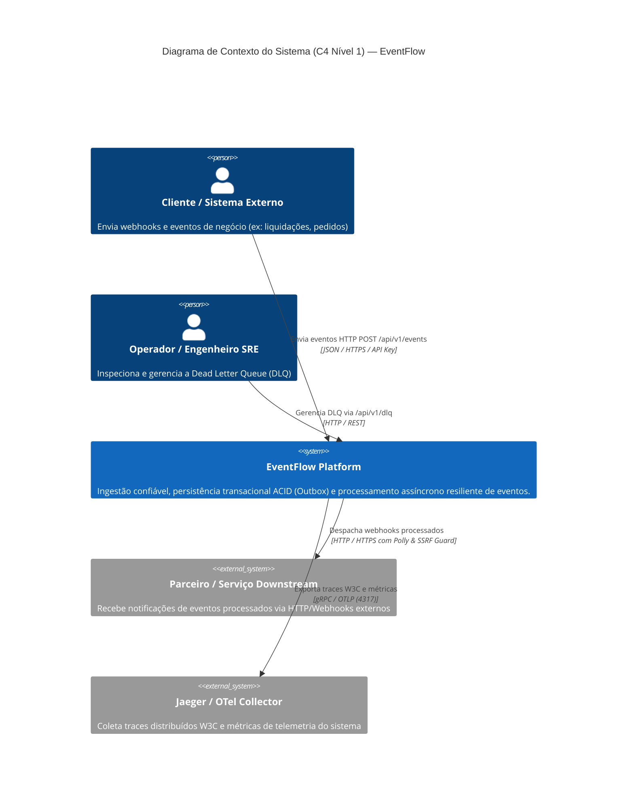
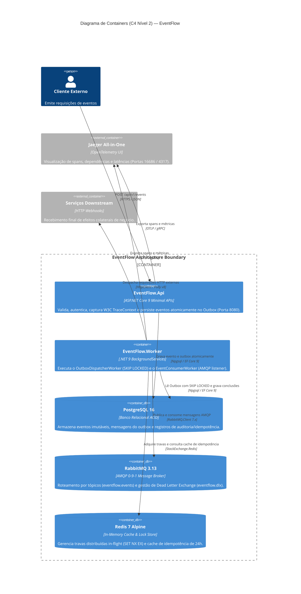
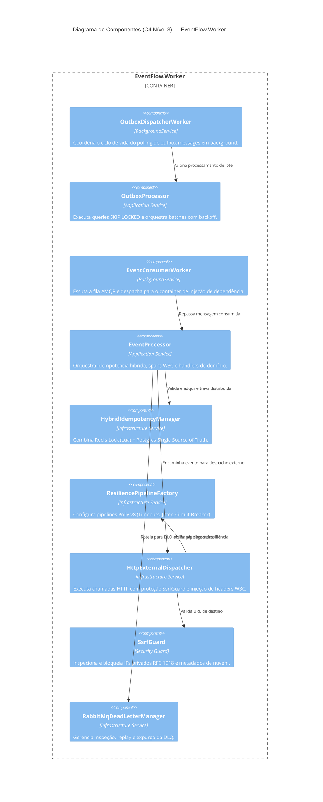
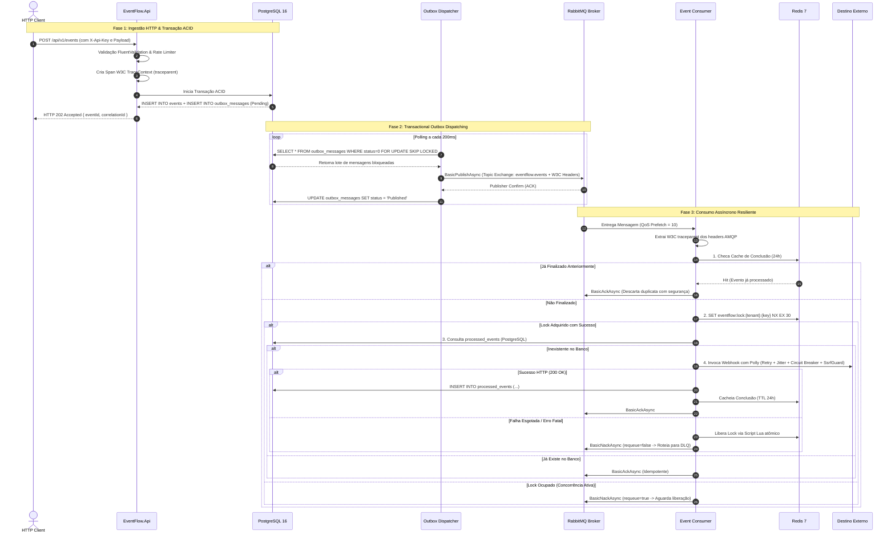

# EventFlow — Diagramas C4 de Arquitetura & Fluxos de Sequência

> **Documento:** Diagramas Estruturais C4 (Contexto, Containers, Componentes) e Sequência Ponta a Ponta  
> **Classificação:** Engenharia e Arquitetura de Software  
> **Status:** Aprovado e Implementado (Fases 1 a 12)  

---

## 1. C4 Nível 1: Diagrama de Contexto do Sistema

O Diagrama de Contexto descreve o posicionamento do **EventFlow** em relação aos atores externos, clientes de API, destinos de webhooks e sistemas de observabilidade.

---

## 2. C4 Nível 2: Diagrama de Containers

O Diagrama de Containers detalha as aplicações em execução, bancos de dados, brokers de mensageria e ferramentas auxiliares que compõem a solução.

---

## 3. C4 Nível 3: Diagrama de Componentes (Worker & Consumo)

O Diagrama de Componentes detalha a arquitetura interna dos módulos de processamento assíncrono do Worker:

---

## 4. Diagrama de Sequência de Ponta a Ponta (End-to-End Flow)

O fluxo completo detalha a jornada do evento desde a requisição HTTP inicial até a confirmação assíncrona ou Dead Lettering:

